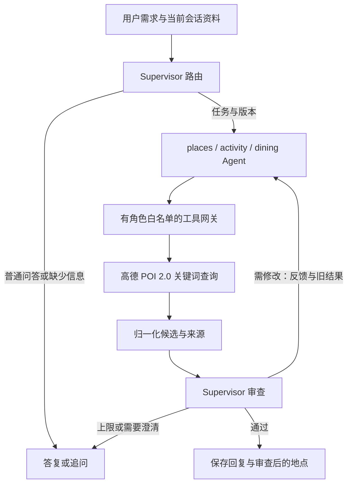

# Supervisor 地点搜索

本阶段提供城市内关键词地点搜索，以及可按需加载的高德地图。用户可在对话中提问，也可在右侧输入城市和关键词。完整游玩需求现在进入 [同城行程流程](ITINERARY.md)，包括路线查询、时间安排与回答内地图。GPS 定位、周边半径、天气和营业/价格核验尚未实现。

## 任务分发、审查和修改

- 所有用户消息先经过 Supervisor。普通问答仍可用一次模型调用完成；地点需求最多分派两个独立任务，餐饮交给 dining，游玩交给 activity，其他地点交给 places。
- 子 Agent 使用独立受控 Prompt 和任务上下文制定搜索参数，只有其白名单中的 `search_local_places` 工具可被执行。不能修改城市、供应商地址或凭证，也不能递归创建 Agent。
- Supervisor 看到结构化供应商候选后，可以选择已观测的 evidence_id，通过、追问或退回指定任务。退回必须含当前任务版本和明确反馈；对应专家接收反馈和旧结果，版本递增后重搜，其他任务结果保留。
- 默认最多两轮返工。超过上限时返回未通过审查的说明，不发布待审候选；不存在无上限的自动重试。工具失败、无结果、审查未通过和用户需要澄清分别处理。
- 工程层验证 JSON、候选 ID、任务版本和权限；模型语义审查仍需真实场景评测，不等于已经确认营业、价格、环境或路线可行性。
- 当前采用 Python 异步状态机；没有启用 LangGraph 或 MCP 传输。任务调度、工具和模型请求共用原 RunBudget、deadline、取消和租约，不为子 Agent 创建新额度。

## 地图来源与历史

地图候选只来自固定的 `https://restapi.amap.com/v5/place/text`，参数使用 region、city_limit=true、单个关键词和最多 5 个候选。所有点标记使用同一归一化 Place 的 GCJ-02 坐标；不由模型补画坐标或路线。

每个发布地点带 `[M编号]`、高德 POI ID、地址、类别、来源、查询时间和处理它的 Agent。Supervisor 只选择实际返回的候选；模型引用未知地图编号时标为“地图来源未核实”。地图结果、返工次数和简短任务事件保存在当前会话消息中，读取消息和 Run 时继续校验用户/会话归属。记录包含行动与反馈，不保存模型 reasoning 字段。

历史结果是当时的观测，不表示持续有效。当前不使用跨用户地点缓存；地图资料的存储和保留应按供应商授权条款管理，删除会话会级联清理其记录。

## 配置

| 配置 | 作用 |
| --- | --- |
| `DEEPSEEK_API_KEY` / `DEEPSEEK_MODEL` | Supervisor 与所有专家共用，结构化请求启用 JSON 输出并由 Pydantic 再校验 |
| `AMAP_WEB_SERVICE_KEY` | 后端地点查询；缺少时明确报未配置 |
| `AMAP_JS_API_KEY` | 已登录页面读取的公开 JS Key，需配置对应域名/IP 的访问限制 |
| `AMAP_JS_SECURITY_CODE` | 只供后端固定样式安全代理使用，不返回前端 |
| `DEFAULT_CITY` | 可选默认城市；不明确时 Supervisor 应追问 |
| `MAP_TIMEOUT_SECONDS` | 地点请求超时，默认 10 秒，并受原 Run 剩余时间限制 |
| `MAX_REVIEW_ROUNDS` | 额外返工轮数，默认 2，可设 0—2 |

Compose 已透传上述参数及 Run 的工具、LLM、外部请求和并行限制。更新代码后执行 `docker compose up -d --build --wait`。修改 `.env` 后需重新创建 backend。

`GET /api/v1/maps/config` 需要登录，只返回公开 JS Key、显示是否配置和默认城市。前端只有用户点击“显示高德地图”后才加载 SDK；无 JS Key 时仍可搜索、看来源和点击“在高德查看”。

SDK 仅使用 `/api/v1/maps/_AMapService/v4/map/styles` 固定代理，在后端加入安全密钥，限定参数、体积、超时及每进程每分钟 60 次访问。它只提供公开地图样式，不代理地点搜索或任意 URL。CSP 放行高德/高德底图域名，跨站请求只发送页面 origin，不发送会话 URL。地图显示请求独立于 Agent 业务工具预算。

## 验证

`python scripts/smoke_map_workflow.py` 使用临时 SQLite 和假密钥，覆盖两个专家分派、审查退回、定向重搜、来源发布、Run 计数和幂等。测试不会访问真实 DeepSeek / 高德。

2026-11-24 已使用临时数据库和公开杭州样例，跑通真实 DeepSeek、高德地点与公交行程查询，并单独确认步行/驾车接口可返回方案。模拟测试覆盖权限、取消、预算和返工边界。真实浏览器 SDK 加载与 Tavily 鉴权尚未验证；单个样例通过不等于所有地点、未来交通或营业情况均已核实。

官方依据：[高德 POI 2.0](https://lbs.amap.com/api/webservice/guide/api-advanced/newpoisearch)、[JS 安全密钥代理](https://lbs.amap.com/api/javascript-api-v2/guide/abc/jscode)、[单点标注 URI](https://lbs.amap.com/api/uri-api/guide/mobile-web/point)、[DeepSeek JSON 输出](https://api-docs.deepseek.com/guides/json_mode/)。
