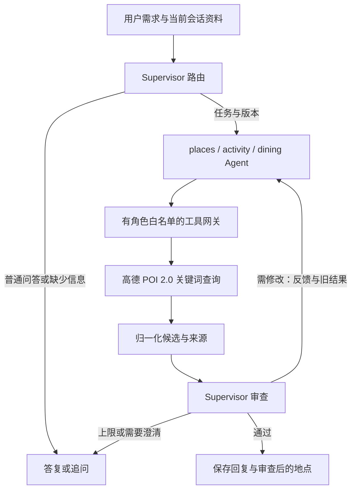

# Supervisor 地点搜索

本阶段提供城市内关键词地点搜索、以已确认机构/校区为中心的周边推荐，以及可按需加载的高德地图。用户可在对话中提问，也可在右侧输入城市和关键词。完整游玩需求进入 [同城行程流程](ITINERARY.md)，包括路线查询、时间安排与回答内地图。GPS 定位、自选周边半径、天气和营业/价格核验尚未实现。

## 先给建议与校区选择

“大学附近吃饭，吃完打台球，推荐距离近的方案”使用 `nearby` 推荐流程；没有要求时间表时，不强行追问出发时刻、人数、口味或精确校门。

Supervisor 可决定任务类型、专家调用顺序、推荐优先级、推荐数量（`recommendation_count`）和比较区域数量（`area_limit`）。数量提示在系统提示词中给出：无明确要求时店铺比较可考虑 3—5 家，想多比较可考虑 5—8 家；这些只是建议，不是上下限。明确数量优先，最终清单由 Supervisor 审查决定，程序不按数量截断。程序继续校验用户约束、工具权限、真实来源和 Run 预算。

“找一家安静的咖啡馆，喝咖啡、看书，再逛周边”无需先给地标：`anchor_name` 可以留空。先按已知或默认城市分派餐饮专家搜索，Supervisor 选择主要目的地，再以该真实地点为中心搜索后续活动。地点选择、后续活动及实际步行衔接分别审查；安静程度、插座和久坐条件等不能从 POI 数据确认的信息不会被声称已核实。没有城市或任何位置上下文时只询问必要位置。

1. Supervisor 将机构名称交给 places 专家，以用户给定的名称查询实际地点。多个校区时，由 Supervisor 从实际主体候选中选择要比较的区域及数量，不把楼宇和技术中心当成另一个校区。
2. 每个区域分别交给 dining/activity 专家，固定高德已观测的中心坐标，在 2000 米圆形范围搜索；专家只能选择关键词，不能改中心和半径。程序也过滤范围外结果。
3. Supervisor 沿用审查与定向返工流程，按推荐优先级选择地点，页面保留所有已通过的选择。`alternatives` 用于多家店铺比较，不把清单强行串成行程；`combine` 用于顺序组合，可围绕多处主要目的地分别推荐。组合恰好两处时可查询实际步行衔接，失败时仍保留地点建议。
4. 用户回复“凌水校区”“第一个”等选项时，从本会话已保存的区域和任务中接续，不重新让模型猜地区。任务、地点及来源保存在原消息 JSON 中，无需数据库迁移，不跨用户或会话复用。

推荐主题、任务与比较方式保存在 `recommendation_context`；主要目的地保存在 `destinations`，只有一处时也写入兼容字段 `destination`。短追问“多推荐几家”交给 Supervisor 结合最近推荐的城市、区域、偏好与已展示地点继续处理，专家相应增加候选池，审查优先补充不同地点。后续周边搜索暂时失败时仍保留已审查的主要目的地；预算不足、取消和截止时间不会因此被绕过。

补充校区也支持省略学校名或使用不同括号，例如“凌水校区”可匹配“某大学（凌水校区）”；“某大学（凌水校区技术中心）”不会导致主体校区再次变成歧义项。真正存在多个同名校区时仍需确认。新的实质问题不会被旧的选项状态覆盖。

明确给出日期时段、返程或要求精确时间表时仍使用 `plan`。实际城市和地点确实无法识别，或用户条件矛盾时，才针对缺失的关键信息提问。

## 任务分发、审查和修改

- 所有用户消息先经过 Supervisor。普通问答仍可用一次模型调用完成；地点需求最多分派两个独立任务，餐饮交给 dining，游玩交给 activity，其他地点交给 places。
- 子 Agent 使用独立受控 Prompt 和任务上下文制定搜索参数，只有其白名单中的 `search_local_places` 工具可被执行。不能修改城市、供应商地址或凭证，也不能递归创建 Agent。
- Supervisor 看到结构化供应商候选后，可以选择已观测的 evidence_id，通过、追问或退回指定任务。退回必须含当前任务版本和明确反馈；对应专家接收反馈和旧结果，版本递增后重搜，其他任务结果保留。
- 默认最多两轮返工。超过上限时提示用户调整区域或要求，不发布待审候选；不存在无上限的自动重试。工具失败、无结果、审查未通过和用户需要澄清分别处理。
- 工程层验证 JSON、候选 ID、任务版本和权限；模型语义审查仍需真实场景评测，不等于已经确认营业、价格、环境或路线可行性。
- 当前采用 Python 异步状态机；没有启用 LangGraph 或 MCP 传输。任务调度、工具和模型请求共用原 RunBudget、deadline、取消和租约，不为子 Agent 创建新额度。

## 地图来源与历史

地图候选只来自固定的 `https://restapi.amap.com/v5/place/text` 和 `/v5/place/around`。参数使用 region、city_limit=true 和单个关键词；候选池大小由专家依据用户数量要求和筛选需要决定。适配器按高德单页最多 25 条分页，同一查询最多读取 200 条，遇到不足一页或没有新结果时停止；这是供应商查询容量，不是回答数量规则。每页继续占用原 Run 的外部请求预算并检查截止时间。周边中心来自已观测的 Place，半径固定 2000 米。所有点标记使用同一归一化 Place 的 GCJ-02 坐标；不由模型补画坐标或路线。

每个发布地点带 `[M编号]`、高德 POI ID、地址、类别、来源、查询时间和处理它的 Agent。Supervisor 只选择实际返回的候选；模型引用未知地图编号时标为“地图来源未核实”。地图结果、返工次数和简短任务事件保存在当前会话消息中，读取消息和 Run 时继续校验用户/会话归属。记录包含行动与反馈，不保存模型 reasoning 字段。

用户页面只展示地点标签、名称、地址、类别、来源与地图链接；内部编号、坐标系和任务审查记录不展示。生成中统一显示排队或生成状态，不复述 Agent 分工和审查步骤。

历史结果是当时的观测，不表示持续有效。当前不使用跨用户地点缓存；地图资料的存储和保留应按供应商授权条款管理，删除会话会级联清理其记录。

## 配置

| 配置 | 作用 |
| --- | --- |
| `DEEPSEEK_API_KEY` / `DEEPSEEK_MODEL` | Supervisor 与所有专家共用，结构化请求启用 JSON 输出并由 Pydantic 再校验 |
| `AMAP_WEB_SERVICE_KEY` | 后端地点查询；缺少时明确报未配置 |
| `AMAP_JS_API_KEY` | 已登录页面读取的公开 JS Key，需配置对应域名/IP 的访问限制 |
| `AMAP_JS_SECURITY_CODE` | 只供后端固定样式安全代理使用，不返回前端 |
| `DEFAULT_CITY` | 可选默认城市；不明确时 Supervisor 应追问 |
| `MAP_TIMEOUT_SECONDS` | 地点请求超时，默认 10 秒，并受原 Run 剩余时间限制 |
| `MAX_REVIEW_ROUNDS` | 额外返工轮数，默认 2，可设 0—2 |

Compose 已透传上述参数及 Run 的工具、LLM、外部请求和并行限制。更新代码后执行 `docker compose up -d --build --wait`。修改 `.env` 后需重新创建 backend。

`GET /api/v1/maps/config` 需要登录，只返回公开 JS Key、显示是否配置和默认城市。前端只有用户点击“显示高德地图”后才加载 SDK；无 JS Key 时仍可搜索、看来源和点击“在高德查看”。

SDK 仅使用 `/api/v1/maps/_AMapService/v4/map/styles` 固定代理，在后端加入安全密钥，限定参数、体积、超时及每进程每分钟 60 次访问。它只提供公开地图样式，不代理地点搜索或任意 URL。CSP 放行高德/高德底图域名，跨站请求只发送页面 origin，不发送会话 URL。地图显示请求独立于 Agent 业务工具预算。

## 验证

`python scripts/smoke_map_workflow.py` 使用临时 SQLite 和假密钥，覆盖两个专家分派、审查退回、定向重搜、来源发布、Run 计数和幂等。测试不会访问真实 DeepSeek / 高德。

数量回归覆盖同一会话追加店铺、保留 12 家已审查地点、比较三个区域及多个主要目的地组合，以及跨页查询继续使用原预算。前端测试检查完整地点列表和来源标签。

2026-11-24 使用临时数据库验证了大连咖啡馆三轮真实对话：先找一家并推荐周边，接着“我需要多推荐几家”返回 5 家，再要求 8 家时查询并返回 8 家不同咖啡馆。数量由模型路由及审查决定，未通过程序补齐或截断；该样例不代表所有区域都能查到足够候选。

2026-11-24 已使用临时数据库和公开杭州样例，跑通真实 DeepSeek、高德地点与公交行程查询，并单独确认步行/驾车接口可返回方案。模拟测试覆盖权限、取消、预算和返工边界。真实浏览器 SDK 加载与 Tavily 鉴权尚未验证；单个样例通过不等于所有地点、未来交通或营业情况均已核实。

官方依据：[高德 POI 2.0](https://lbs.amap.com/api/webservice/guide/api-advanced/newpoisearch)、[JS 安全密钥代理](https://lbs.amap.com/api/javascript-api-v2/guide/abc/jscode)、[单点标注 URI](https://lbs.amap.com/api/uri-api/guide/mobile-web/point)、[DeepSeek JSON 输出](https://api-docs.deepseek.com/guides/json_mode/)。
