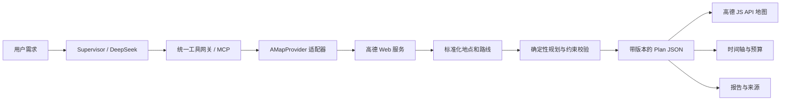

# 模型与地图供应商接入方案

更新日期：2026-11-21。DeepSeek API 已由项目所有者确定；高德为国内场景的首选建议，真实适配器及页面尚未联调。

## 模型：DeepSeek API

- 适配器：`app/integrations/deepseek.py`；官方 OpenAI 兼容请求格式。
- Base URL：`https://api.deepseek.com`；模型通过 `DEEPSEEK_MODEL` 配置。
- 骨架默认 `deepseek-flash`，具体业务模型在冻结评测后确定，不把型号写死到各个 Agent。
- 所有角色共享同一个供应商配置，依靠工具权限、上下文与任务契约分工。
- 每次实际模型请求先占用 LLM 和 external 预算；不启用隐式重试。
- 只返回回答内容，不向用户输出供应商 reasoning 字段；错误不回传原始供应商响应。
- 已接入非流式多轮文字聊天运行器。用户提问时，将当前会话上下文和授权召回片段发送至配置的 DeepSeek `/chat/completions` 接口；不发送其他用户或会话专属资料。
- 私有文本检索目前在本地使用关键词匹配，不调用外部 Embedding / Rerank。来源标签由服务端真实召回结果生成，详见 [聊天和来源说明](CHAT_AND_RAG.md)。
- Embedding 和 Rerank 使用独立接口，后续选型并评测，不假定聊天 API 同时提供二者。

## 地图：后端服务与前端展示分别接入

DeepSeek 理解偏好、提取条件、选择工具、解释结果；地图服务给出地点和路线观测；规划程序计算时间、预算并保留锁定事项。前端使用已校验的路线几何与计划版本，不能另行算路覆盖已验算结果。

## 后端适配器的实施顺序

| 顺序 | 目标工具 | 高德能力 | 归一化产物 |
| --- | --- | --- | --- |
| 1 | 位置解析 | 地理编码 / 输入提示 | POI ID、城市/行政区、经纬度、坐标系 |
| 2 | search_local_places | POI 关键词 / 周边搜索 | 少量候选、名称、类别、地址与来源 |
| 3 | get_place_details | POI 详情 | 可取得的营业/联系信息和未确认项 |
| 4 | get_route | 步行、公交、驾车路线 | 距离、估计耗时、路线几何、费用状态 |
| 5 | get_weather | 天气查询 | 官方可用预报范围内的天气与采集时间 |

第一版聚焦一个城市和“步行 + 公交”，驾车作为后续扩展。天气超出供应商可用日期范围时明确未知。天气与营业时间不能用模型补造。

`app/integrations/contracts.py` 定义 `MapProvider`，`app/schemas/planning.py` 定义 `Place / Coordinates / RouteLeg`。完整适配器后续实现，不直接把高德原始 JSON 传遍业务模块。

- 对中国大陆地图链路统一使用并标注 `GCJ02`；外部 GPS/WGS84 坐标先经受控转换，禁止混用。
- 保留 provider + POI ID、数据采集时间和来源；地点同名需要城市/用户确认，不能随意取第一项。
- 距离用整数米，时长用整数秒，费用用整数分；费用未知保留 `null`。
- 供应商返回 HTTP 200 时仍检查业务状态码；区分查无结果、权限/配额不足、超时与服务故障。
- 高德 Key 只从服务端配置读取，不接受模型传入 Key、URL、user_id 或任意供应商地址。
- 工具与内部外部请求分别计数，限制候选数量和算路组合，超时不重置总 deadline。
- 对外部事实的缓存与保留周期按供应商授权、场景时效和隐私范围配置；不预设可以永久存储所有地图数据。
- 营业、价格和预约存在缺失或不确定时记录待确认，不把空费用当作免费，也不把行驶费当作全部交通费用。

## 前端与密钥

需要分开申请：

1. **Web 服务 Key**：仅后端 REST 查询使用。
2. **Web 端 JS API Key**：前端加载 JS API 2.0，按部署域名限制。
3. **JS 安全密钥**：按官方推荐放在服务端的固定安全代理；前端配置 `serviceHost`，不返回安全密钥明文。

SDK 的固定安全代理与业务工具网关用途不同：前者服务于地图 SDK 加载和展示，业务地点/算路仍由后端工具链发起并计入 Run 预算。代理只允许必要的固定高德目标，避免变成任意转发入口。

注册认证后，在高德控制台核对所选 API 的权限、配额和使用范围。免费额度、商业授权与服务价格以当前账户和高德条款为准，本方案不假定全部能力免费。

## 联调验收

- 密钥缺失时应用仍可启动；调用相应能力时清晰报未配置。
- 地点坐标与网页标记一致，路线与时间轴、报告使用同一 Plan 版本。
- 密钥错误、限流、无结果、网络超时分别有测试；错误日志中无 Key。
- 同一 Run 的多个 Agent 共用预算；取消后晚到结果不得发布计划。
- 完成真实供应商冒烟后再宣称地图能力可用；现有模拟测试不代表实时准确性。

## 官方依据

- [DeepSeek API 接入](https://api-docs.deepseek.com/)
- [高德 POI 搜索 2.0](https://lbs.amap.com/api/webservice/guide/api-advanced/newpoisearch)
- [高德路线规划 2.0](https://lbs.amap.com/api/webservice/guide/api/newroute)
- [高德坐标转换](https://lbs.amap.com/api/webservice/guide/api/convert)
- [高德 JS API 安全密钥](https://lbs.amap.com/api/javascript-api-v2/guide/abc/jscode)
