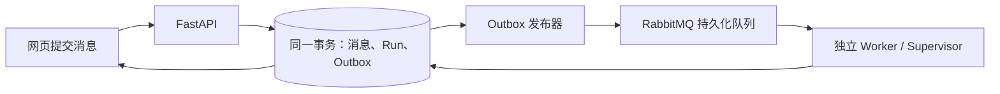

# 后台任务与会话切换

Docker 使用 RabbitMQ + 独立 `worker` 容器执行聊天和完整 Supervisor 工作流。网页只负责提交任务、读取进度和展示结果。切换会话、刷新或关闭页面不会发出取消请求，也不影响后台执行。重新打开会话会查询 `/api/v1/conversations/{id}/runs/latest` 恢复状态，结果完成后从 SQLite 加载。

## 数据与执行



- 提交接口立即返回 `202` 和 Run ID。消息、租约及 `run_jobs` Outbox 在一个 SQLite 事务中保存；RabbitMQ 暂时不可用时仍保留待发布任务。发布成功需 broker confirm，未确认的记录保留并重试。
- RabbitMQ 队列为 durable quorum queue，消息为 persistent；消费者在结果/终态落库后手动 ACK。固定节点名和独立 `rabbitmq_data` 卷保留 broker 数据。单节点部署不等于高可用集群。
- 消息只包含版本和 Run ID，不传会话正文、Token 或供应商密钥。Worker 从数据库取得归属用户，沿用原会话权限、任务预算、截止时间和 fencing token。重复投递不会从头重复生成。
- 默认每个 Worker 最多同时执行两个任务。API 在 queue 模式重启时不会把所有运行任务标成中断。用户主动取消或删除会话后，Worker 通过数据库状态中止并拒绝迟到结果。
- Worker 每两秒写入活跃任务心跳。Worker 意外退出后，超过默认30秒未更新的任务会标为 `interrupted/WORKER_LOST`；已可能调用供应商的任务不会自动从零重跑，避免重复计费和重置预算。用户可显式重发。尚未领取的队列任务可在 Worker 恢复后继续。
- 排队时间计入现有 `RUN_TIMEOUT_SECONDS`（默认240秒），过期任务标为超时，不在恢复连接后无限续期。

前端按会话跟踪 Run，侧栏显示排队/生成状态，切换时只切换展示。进度轮询取消原来的130秒前端上限，临时网络错误会继续重连。账号退出会清空本地跟踪；服务端接口始终验证归属，不依赖缓存实现隔离。

## 配置和运行

`.env` 需要 `RABBITMQ_PASSWORD`。当前本机已生成随机密码；不要输出或提交。新环境可用 Python 的 `secrets.token_hex(24)` 生成，再复制 `.env.example` 中的配置。Broker 不发布宿主机端口，也不开放管理控制台。

```powershell
docker compose up -d --build --wait
docker compose ps
```

应看到 `frontend`、`backend`、`worker`、`rabbitmq` 四个服务健康。入口仍由 `GOMATE_WEB_PORT` 控制。API 与 Worker 共用 `gomate_data` 中的 SQLite，但在不同进程内执行；SQLite 仍要求同一台 Docker 主机，不支持把该卷当作跨机器数据库。

修改模型、地图、Tavily 等执行配置后，需要重新创建 **backend 和 worker**，并刷新 Nginx 的后端解析：

```powershell
docker compose up -d --force-recreate --wait
```

原生 `uvicorn` 开发默认 `TASK_EXECUTION_MODE=inline`，方便不启动 broker 的单进程调试；该模式仍受 API 进程生命周期限制。需要原生队列模式时设置 `TASK_EXECUTION_MODE=queue`、RabbitMQ 连接字段，并另开 `python -m app.worker`。Compose 明确固定为 queue 模式。不要让 inline API 与 queue Worker 共享同一数据库。

## 验证

回归覆盖会话切换、刷新恢复、网络重连、跨用户访问、发布失败重试、重复投递、失联 Worker、取消和排队超时。`scripts/smoke_queue.py` 使用真实隔离 RabbitMQ、临时 SQLite 和独立 Worker 子进程，模型为假实现，不调用真实供应商。可通过 `SMOKE_BROKER_RESTART=1` 暂停在发布确认后，重建测试 broker（保留测试卷）再继续，验证持久化。

官方依据：[RabbitMQ ACK 与发布确认](https://www.rabbitmq.com/docs/confirms)、[aio-pika Work Queues](https://docs.aio-pika.com/rabbitmq-tutorial/2-work-queues.html)。

2026-11-24 已完成隔离实测：消息确认后关闭 API、删除并重建测试 broker（保留测试卷）、延后启动独立 Worker，再启动 API，最终正确取得回复；重复投递只触发一次模型执行。整个测试使用假模型，不调用真实模型或地图供应商。
